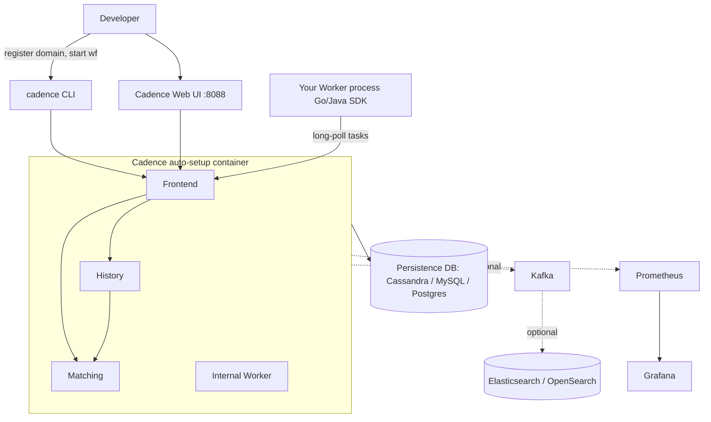
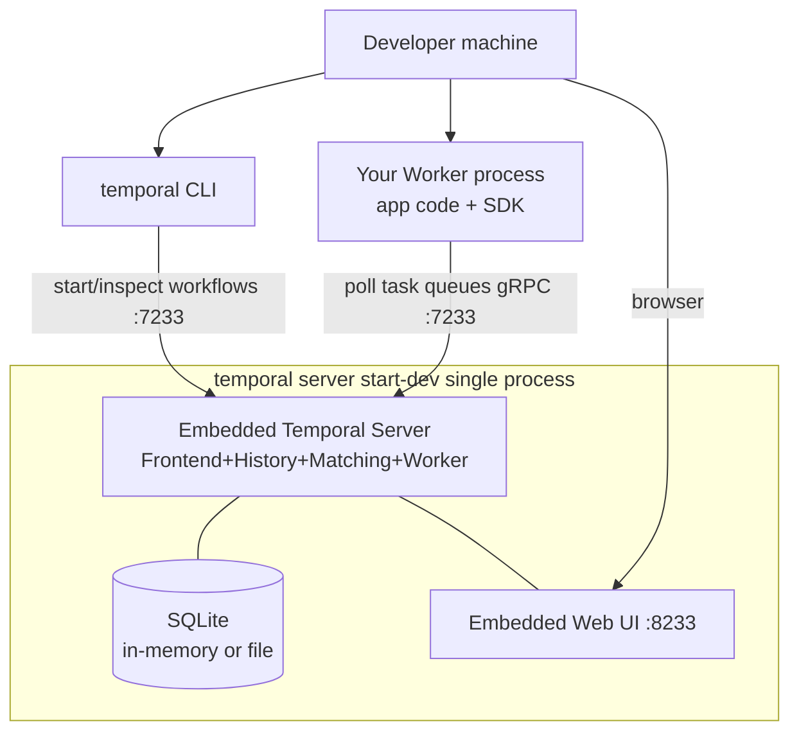
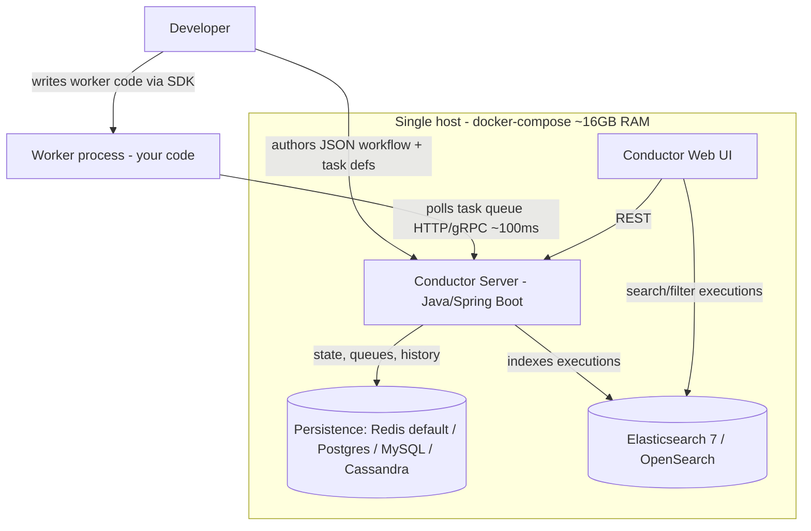
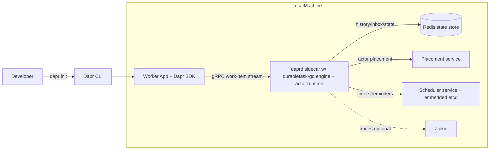
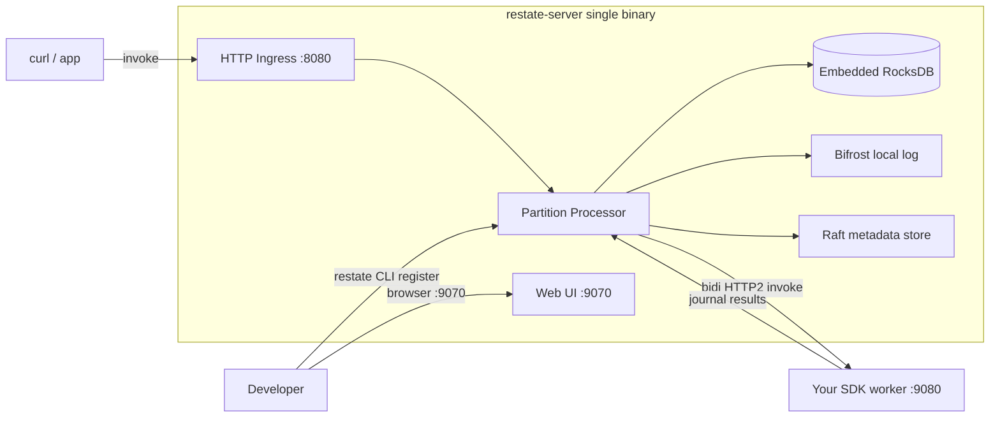
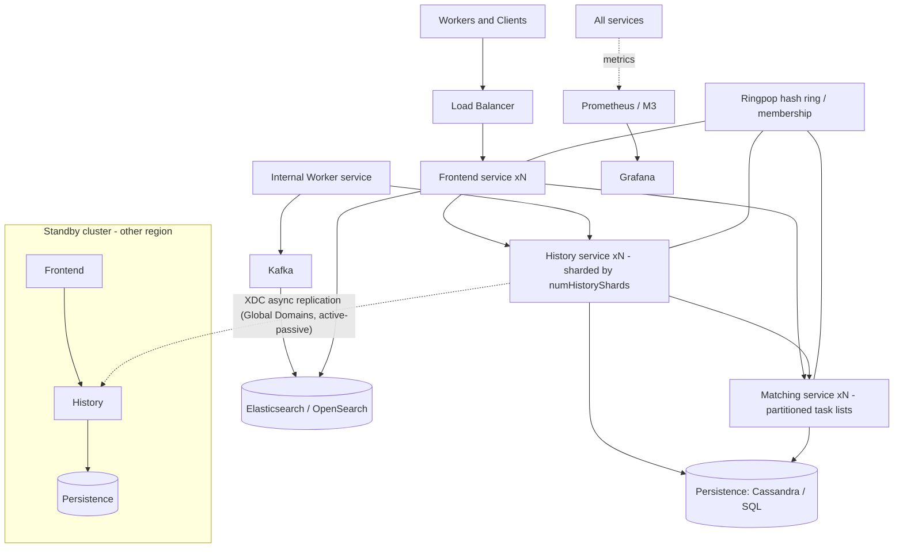
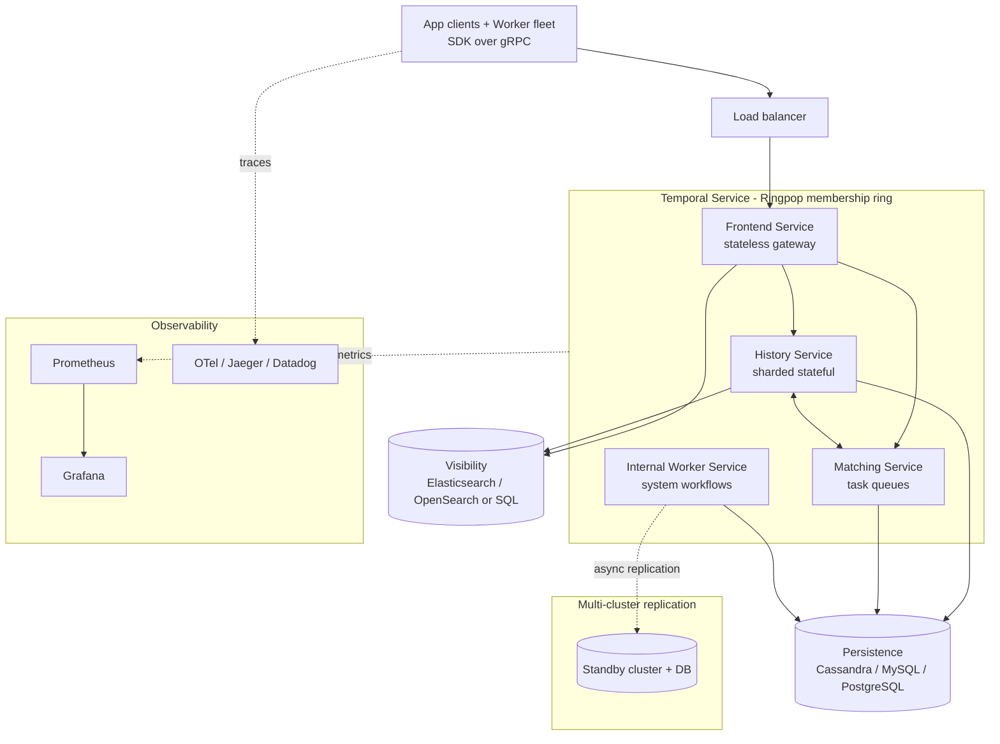
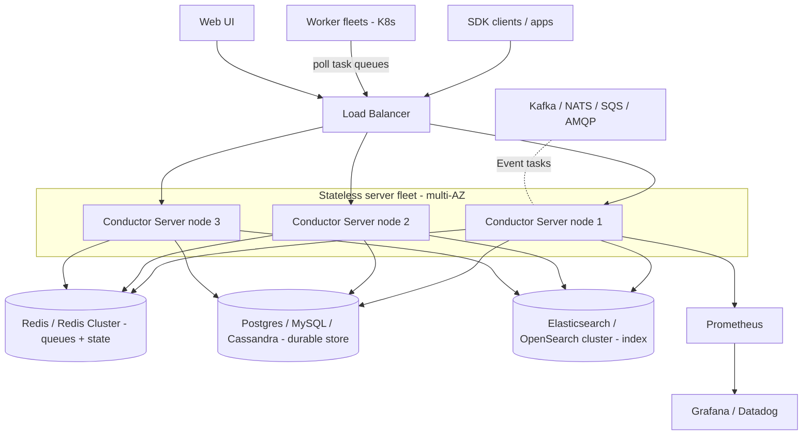
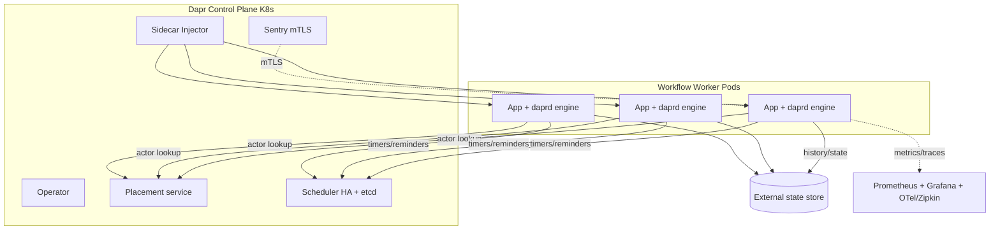
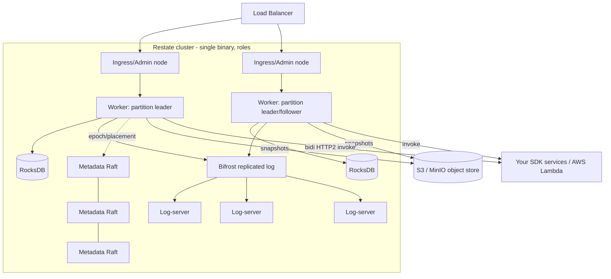

# Durable Execution Engines: Comparative Research Dossier
### Cadence · Temporal · Conductor · Dapr Workflows · Restate

## Sources & freshness

- **Verified:** 2026-05-30. Pricing moves fast — **re-verify the morning of the talk**, especially Temporal Cloud tiers, Orkes/Diagrid/Restate contact-sales terms, and any Instaclustr calculator figures.
- Pricing in this document uses the **verification verdicts as the source of truth**: where a verdict corrected the original research, the corrected number is used and the correction is noted.
- Confidence is marked per pricing item (high / medium / low). Where pricing is contact-sales or only on a JS-rendered page, that is stated explicitly. **No numbers are invented.**
- Vendor self-published figures (e.g., Instaclustr "78% cheaper than Temporal", Orkes benchmarks) are flagged as vendor claims, not independent measurements.
- Author affiliation note: the author works at **Diagrid** (the company behind Dapr/Catalyst). Dapr and the Diagrid offerings are presented even-handedly; competitor strengths are stated plainly.

---

# 1. Local Development

> Goal: what a developer must stand up to write and run a workflow on their laptop.

## 1.1 Cadence

Clone the repo and `docker-compose up`. Fastest path is the **auto-setup** all-in-one server image (`ubercadence/server:master-auto-setup`) which bundles the four backend roles and auto-creates the DB schema, plus a persistence container (Cassandra by default) and the Web UI on `:8088`. Minimal viable stack = server + a database. You run your own Go/Java worker and use the `cadence` CLI to register a domain (mandatory first step) and start/inspect workflows. Elasticsearch, Kafka, Prometheus and Grafana ship in the richer compose files but are **not** needed to run a workflow locally.

| Component | What it is | Why needed | Required |
|---|---|---|---|
| Cadence server (auto-setup image) | All four backend roles (frontend/history/matching/internal worker) in one container, auto-provisions DB schema | "Dev cluster in a box" — the core engine | Required |
| Persistence DB (Cassandra default; MySQL/Postgres variants) | Durable store for histories, mutable state, task/timer queues, domain metadata | Cadence cannot run without a persistence store | Required |
| Worker process (your code) | Go/Java SDK process hosting workflow + activity code, long-polls matching | Server never runs user logic | Required |
| `cadence` CLI | Registers domains, starts workflows, signals, queries, inspects history | Domain registration is a mandatory first step | Required |
| Cadence Web UI (`:8088`) | Browse domains/executions, inspect & replay histories | Strong dev aid, not needed to execute | Optional |
| Elasticsearch / OpenSearch | Advanced Visibility (list/search by custom attributes) | Without it you get only basic type/status filtering | Optional |
| Kafka | Feeds visibility records into ES; some async/replication paths | Only when advanced visibility/ES enabled | Optional |
| Prometheus + Grafana | Metrics scraping + prebuilt dashboards | Tuning/observability only | Optional |

## 1.2 Temporal

Almost nothing beyond a single binary. `temporal server start-dev` boots an embedded server (all four services in-process), SQLite persistence, an embedded Web UI, and a default namespace — zero external dependencies. Persistence is in-memory by default (state lost on restart); `--db-filename temporal.db` persists to a file. gRPC frontend on `:7233`, Web UI on `:8233`. You write a Worker process embedding a Temporal SDK; the same `temporal` CLI starts/inspects workflows. SDK time-skipping test frameworks let you unit-test workflow logic with no server running.

| Component | What it is | Why needed | Required |
|---|---|---|---|
| `temporal` CLI dev server (`server start-dev`) | Self-contained binary bundling server + SQLite + Web UI | Canonical zero-dependency local/CI backend in one command | Required |
| Embedded Temporal Server | Frontend+History+Matching+internal Worker in-process | The backend your app talks to over gRPC `:7233` | Required |
| SQLite persistence | Embedded file/in-memory DB | Stores state & histories; file mode survives restart | Required |
| Worker process (your app + SDK) | Long-running process registering Workflow/Activity functions, polling task queues | Server never runs your business logic | Required |
| Embedded Web UI (`:8233`) | Bundled UI for executions, histories, stack traces | Free with dev server; not strictly required | Optional |
| `temporal` CLI (client commands) | Trigger/inspect workflows without a starter program | SDK client can do the same from code | Optional |
| SDK test server / time-skipping | In-process test env that skips timers | Fast deterministic unit tests of long timers | Optional |

## 1.3 Conductor (conductor-oss / Orkes)

`docker-compose up` launches the Conductor Server (REST/gRPC + state-machine engine), the bundled Web UI, a persistence store (Redis by default), and a search index (Elasticsearch 7 by default) — all on one host. Plan for ~16 GB RAM (JVM server + Elasticsearch). You register workflow + task definitions as JSON, then run a worker (Java/Python/Go/JS/C#/Clojure) that polls the server. ES/OpenSearch is technically optional (`conductor.indexing.enabled=false`) but the UI is mostly non-functional without it. The commercial all-in-one `orkes-conductor-standalone` image needs an Orkes Cloud token; the zero-install **Orkes Developer Edition** browser playground is the easiest commercial dev option.

| Component | What it is | Why needed | Required |
|---|---|---|---|
| Conductor Server (Java/Spring Boot) | Stateless REST+gRPC orchestration brain; state-machine evaluator scheduling tasks to queues | Stores/advances workflow state; workers poll it | Required |
| Persistence backend (Redis default; Postgres/MySQL/Cassandra/SQLite) | Durable store for defs, queues, execution history | Durable execution requires surviving restarts; queues hand work to pollers | Required |
| Worker process (your code, via SDK) | Long-running process polling a task type (~100ms), running logic, posting results | The server only orchestrates; this runs your logic | Required |
| Search index (Elasticsearch 7 default / OpenSearch) | Secondary index of executions for search/filter & UI views | Technically optional, but UI is mostly broken without it | Optional (practically needed) |
| Conductor Web UI | Inspect/search executions, view diagrams | Debugging; depends on the search index | Optional |
| SDK / client library | Author workers; register/start workflows programmatically | JSON DSL can also be hand-authored or via UI | Optional |
| `orkes-conductor-standalone` image | Single image with full commercial stack | Needs an Orkes Cloud subscription/token | Optional |

## 1.4 Dapr Workflows

`dapr init` (self-hosted) pulls Docker containers and writes defaults to `~/.dapr`: Redis (state + pub/sub), Zipkin (tracing), Placement, and Scheduler. You write workflow + activity code with a Dapr SDK (.NET, Java, Python, Go, JS) and run with `dapr run`, which launches a `daprd` sidecar. The sidecar contains the embedded `durabletask-go` engine; your app connects over gRPC and pulls work items. Minimum viable stack: one state store (Redis), Placement, Scheduler, the `daprd` sidecar, and your worker app. Zipkin is optional. `dapr init --dev` gives a dev-server-in-a-box.

| Component | What it is | Why needed | Required |
|---|---|---|---|
| Dapr CLI (`dapr`) | `dapr init` provisions control plane + default components; `dapr run` launches app+sidecar | Wires app + sidecar + control plane locally | Required |
| `daprd` sidecar (embedded workflow engine) | Per-app runtime hosting `durabletask-go` + actor runtime + building-block APIs | This IS the workflow execution host — no separate server | Required |
| Worker / app process + Dapr SDK | Your workflow + activity code; connects to `daprd` over gRPC, pulls work items | Contains the business logic the engine drives | Required |
| State store (Redis default; any txn+ETag store) | Durable backend for history/inbox/status, via the actor state store | Replayable state needs transactional + optimistic-concurrency store | Required |
| Placement service | Maintains actor distribution/lookup table, load-balances actors | Workflow durability rides on virtual actors | Required |
| Scheduler service (embedded etcd) | Stores/fires jobs, actor reminders, and the reminders backing workflow timers/durability | Stable since v1.15; workflows misbehave without it | Required |
| Zipkin (tracing) | Default tracing container | Local debugging only | Optional |
| Diagrid Catalyst Cloud (free) | Hosted managed Dapr endpoint your app dials remotely | Removes need to run control plane/state store locally | Optional |

## 1.5 Restate

Genuinely single-binary. Download (curl/Homebrew) or `docker run` ONE `restate-server` that bundles the runtime, embedded RocksDB, the durable log, the metadata store, and the Web UI — no separate database, broker, search index, or sidecar. You write handlers with a Restate SDK (TypeScript, Python, Java, Kotlin, Go, Rust), run that worker as a plain HTTP server, and register it with `restate deployments register <url>` (or the UI). Mental model: the server is the durable orchestrator/proxy; your code is a stateless HTTP service the server calls.

| Component | What it is | Why needed | Required |
|---|---|---|---|
| `restate-server` (single binary) | Runtime + embedded RocksDB + Bifrost log + Raft metadata store + ingress (`:8080`) + admin/UI (`:9070`) | Why local setup needs no external DB/broker/index | Required |
| SDK worker process (your code) | Handler code (TS/Python/Java/Kotlin/Go/Rust) as a normal HTTP service (`:9080`); server pushes invocations over bidi HTTP/2 | Server orchestrates but does not run your logic | Required |
| `restate` CLI | Register deployments, invoke handlers, inspect/cancel invocations, read state | Needed to connect your worker the first time (UI can also) | Required |
| Restate Web UI (`:9070`) | Register deployments, browse invocations, view journal/state, replay | Primary local introspection tool; no separate install | Optional |
| Object store (S3/MinIO) | Partition snapshots & log trimming | Not needed for single-node local dev | Optional |
| `restatectl` | Operator cluster control (config, draining, replication, snapshots) | Only for multi-node clusters | Optional |

## 1.6 Cross-engine comparison: local dev footprint

| Engine | Minimal local stack | External DB? | Search index? | Worker code runs where | Easiest start |
|---|---|---|---|---|---|
| Cadence | auto-setup server + DB container | Yes (Cassandra/SQL) | Optional (ES) | Separate process | `docker-compose up` |
| Temporal | single CLI binary | No (embedded SQLite) | No | Separate process | `temporal server start-dev` |
| Conductor | server + Redis + ES (~16 GB RAM) | Yes (Redis + store) | Practically yes (ES) | Separate process | `docker-compose up` |
| Dapr | CLI + sidecar + Redis + Placement + Scheduler | Yes (state store) | No | Same pod as sidecar | `dapr init --dev` |
| Restate | single binary | No (embedded RocksDB) | No | Separate HTTP service | `docker run` / `brew` |

**Slide ideas**
- "Local dev in one command" — rank engines by minimal stack size; highlight Temporal and Restate (single binary) vs Cadence/Conductor (compose + DB + index).
- A consistent five-panel diagram board (one mermaid per engine) showing the dependency count visually.

---

# 2. Production Architecture

## 2.1 Cadence

A horizontally-scaled cluster of four Go services (frontend, history, matching, internal worker) in front of a durable store and optional search/log layers. The history service is sharded into a **fixed, immutable `numHistoryShards`** distributed across hosts via a Ringpop hash ring; each shard serializes updates for its workflows (shard = unit of parallelism). Multi-region HA uses **Cross-DC Replication (XDC)** with Global Domains in **active-passive** only.

Key components: Frontend (stateless gateway), History (stateful, sharded), Matching (task lists + partitioning), Internal Worker (system workflows), Persistence (Cassandra/MySQL/Postgres/CockroachDB/TiDB), Elasticsearch/OpenSearch, Kafka, Ringpop membership (deprecated upstream), external LB, metrics (Prometheus/StatsD/M3) + Grafana.

- **Observability:** rich per-service metrics to Prometheus/StatsD/M3; in-repo Grafana dashboards; Web UI history inspection/replay. Tracing is not first-class. Watch shard metrics, persistence latency, task-list backlog.
- **Scaling:** add hosts for frontend/matching/internal-worker; history scales by spreading the fixed shard count. **Critical:** `numHistoryShards` is immutable after creation, so over-provision up front; per-shard throughput bounded by DB write latency (~10ms write ⇒ ~100 updates/sec/shard). Hot task lists mitigated by partitioning. Strong multi-tenancy (2000+ domains/cluster at Uber scale).
- **HA:** in-region via multiple replicas + replicated persistence; cross-region via XDC Global Domains (ACTIVE in exactly one cluster). No active-active for a single domain. Operator-triggered failover; only at-least-once activity semantics across failover (replication lag can re-dispatch).

## 2.2 Temporal

A horizontally-scaled cluster of four Go services (Frontend, History, Matching, internal Worker) discovering each other via Ringpop. Persistence (Cassandra / MySQL 8+ / PostgreSQL 12+) holds state, histories, timers, queues. Visibility goes to the same SQL DB (standard) or Elasticsearch/OpenSearch (advanced). Workers are your own processes over gRPC. **Unit of scale = History Shard** (fixed at cluster creation, immutable). Self-hosted via official Helm charts; docker-compose for dev/test only.

- **Observability:** Server + SDK Prometheus metrics; reference Prometheus + Grafana; OpenTelemetry/Jaeger/Datadog tracing via SDK interceptors (one trace per workflow execution); Datadog integration; structured logs.
- **Scaling:** Frontend/internal Worker scale as stateless replicas; History/Matching scale by shard and task-queue partition ownership. History Shard count (e.g., 512/4096/16384) is the master, immutable scaling parameter (~1 History instance per ~500 shards). Practical bottleneck is almost always the persistence DB (IOPS/connections) and the ES cluster.
- **HA:** baseline via multiple replicas + clustered DB; multi-cluster async replication (active→passive standby, OSS, historically experimental). On Temporal Cloud: standard namespaces get 3-AZ + 99.9% SLA; **High Availability namespaces** add same-region/multi-region/multi-cloud (AWS↔GCP) active-standby with automatic failover, ~20-min RTO, sub-1-min RPO, 99.99% SLA.

## 2.3 Conductor (conductor-oss / Orkes)

A horizontally scalable cluster of **stateless** Conductor Server nodes (run ≥3 across AZs) behind a load balancer, sharing an external HA data tier: Redis (or Redis Cluster) for state/queues, a relational/NoSQL store (Postgres/MySQL/Cassandra), and Elasticsearch/OpenSearch for indexing. Orkes standardizes on Redis (queues/state) + Postgres. Workers are independent fleets that poll. Brokers (Kafka/NATS/SQS/AMQP) integrate via Event tasks.

- **Observability:** comprehensive Prometheus metrics out of the box → Grafana/Datadog. Orkes Cloud provisions managed dashboards/analytics/alerts; self-hosted brings its own. Tracing is not first-class.
- **Scaling:** stateless servers scale by adding nodes — engine layer rarely the bottleneck. Pressure is on the data tier: Redis (scale-up / Redis Cluster) and Postgres CPU/IOPS. Orkes benchmark flags the worker "task update back to server" as the throughput-limiting op, mitigated by async writes. **Vendor benchmark (single cluster):** ~210 sustained workflows/sec, 1,450+ task executions/sec, ~80 MB/sec, 2,000+ workflow-starts/sec burst, JVM heap <~2 GB.
- **HA:** ≥3 interchangeable stateless nodes across AZs; HA requires the data tier in replicated mode. Orkes advertises up to 99.99% with auto-failover; Orkes Cloud offers Orkes-hosted or in-your-VPC. Active-active multi-region is an enterprise/contract concern (inference).

## 2.4 Dapr Workflows

Typically Kubernetes: a control plane (Operator, Sentry for mTLS, Placement, Scheduler) + Sidecar Injector. Each workflow worker pod gets a `daprd` sidecar with the embedded `durabletask-go` engine + actor runtime. **There is no dedicated workflow cluster** — the engine scales with your app pods; Placement load-balances workflow/activity actors. State is event-sourced into an external transactional+ETag store; timers/reminders live in the Scheduler's etcd.

- **Observability:** Prometheus metrics from every sidecar + control-plane service, bundled Grafana dashboards; OpenTelemetry/W3C tracing → Zipkin/Jaeger/Datadog/New Relic; logs via FluentD/Elastic/Kibana. Note: OSS docs do not document workflow-specific dashboards; deeper workflow inspection is via the management API/SDKs or richer UI in Diagrid Catalyst.
- **Scaling:** add worker pods; Placement spreads actors. **Key constraint:** a single workflow instance runs on one node (single-threaded actor) — you can't scale an individual workflow; activities can fan out, but workflow and activity replicas scale together. Bottlenecks: state-store latency/item-size limits, history rehydration on replay, too many active reminders, cluster CPU. Mitigations: continue-as-new, child workflows, scheduled start times, high-throughput state store.
- **HA:** control-plane services run multiple replicas; on K8s Scheduler always runs HA as peers (no single leader). Durability/HA is delegated to the chosen external state store + Scheduler etcd. **Caution:** rescaling Scheduler with embedded etcd risks data loss — use external etcd + `dapr scheduler export` backups. No built-in cross-region workflow replication; multi-region via the datastore's geo-replication.

## 2.5 Restate

The same single binary run as a multi-node cluster, with four colocatable node **roles**: worker, log-server, metadata-server, admin/ingress. The durable log (**Bifrost**, replicated loglet default since v1.4) is the source of truth; each partition has one leader processor tailing the log and materializing state in embedded RocksDB. Object storage (S3/MinIO; GCS/Azure noted as coming) holds snapshots. Your handler code runs OUTSIDE the cluster as stateless HTTP services (containers/K8s/AWS Lambda). Recommended platform: the Kubernetes operator on EKS/AKS/GKE.

- **Observability:** Prometheus-style metrics + OpenTelemetry/Jaeger tracing of invocations; Web UI + admin API give per-invocation journal introspection. The journal itself is an audit trail. Deep dashboarding still relies on wiring metrics/traces into your own stack (inference).
- **Scaling:** key-based sharding — workflow IDs, virtual-object keys, idempotency keys hash to a partition; all steps/state/timers for a key run in one partition with no hot-path cross-partition coordination. Add nodes, raise replication with `restatectl`, lean on snapshots. Bottlenecks: single active leader per partition serializes a hot key; quorum-ack write latency; Raft metadata store is control-plane scale only; cross-partition work goes through an internal shuffler.
- **HA:** replicated log + quorum replication, epoch fencing (no split-brain), controller-driven segment sealing + processor promotion, snapshot-bounded recovery. v1.4 added gossip failure detection (up to 10x faster), automatic partition rebalancing, drain/warm-up leadership transitions. Location-aware replication (`{zone:2,node:3}` / `{region:2,zone:3,node:5}`) for multi-AZ/region; Restate Cloud offers 3-AZ on request. No turnkey active-active multi-region product story — multi-region is a single stretched cluster via location-aware placement (inference).

## 2.6 Cross-engine comparison: production architecture

| Engine | Topology | Stateful core | Scaling unit | Search/index dep | Multi-region story |
|---|---|---|---|---|---|
| Cadence | 4 Go services + DB | History (sharded) | `numHistoryShards` (immutable) | Optional ES | XDC Global Domains, active-passive only |
| Temporal | 4 Go services + DB + visibility | History (sharded) | History Shard count (immutable) | SQL or ES | Multi-cluster async; Cloud HA multi-region/multi-cloud auto-failover |
| Conductor | Stateless server fleet + Redis/SQL/ES | Data tier (Redis/DB) | Add stateless nodes; scale data tier | ES/OpenSearch (practically) | Enterprise/contract (inference) |
| Dapr | Sidecar-embedded engine + control plane | External state store + Scheduler etcd | App pods (single wf = 1 node) | None | Via datastore geo-replication; no built-in wf replication |
| Restate | Single binary, role-based cluster | Worker (RocksDB) + Bifrost log | Partitions (key-hashed) | None | Location-aware single stretched cluster (inference) |

**Slide ideas**
- "Where does the durable state live?" contrast: dedicated sharded cluster (Cadence/Temporal) vs stateless+external data tier (Conductor) vs sidecar+your DB (Dapr) vs self-contained log (Restate).
- "The immutable-shard gotcha" — Cadence/Temporal require sizing shards up front; a one-line caution worth a slide.
- A multi-region maturity row: Temporal Cloud (auto-failover, multi-cloud) at one end, Dapr/Restate (delegated to datastore / stretched cluster) at the other.

---

# 3. Hosting (open source vs commercial)

## 3.1 Cadence
- **OSS (Apache 2.0):** all four services, CLI, Web UI, Go/Java SDKs, official Helm charts (v0, Oct 2024), community Python/Ruby SDKs, schema tooling, iWF abstraction layer (separately licensed, `indeedeng/iwf`).
- **Commercial:** **NetApp Instaclustr Managed Cadence** — fully managed, 100% OSS Cadence on AWS/Azure/GCP/on-prem, managed Cassandra/Kafka/OpenSearch, 99.9% SLA, 24×7 support, multi-region, SOC2/ISO27001/PCI-DSS; RIYOA (run in your own account) or fully-provisioned (RIIA).
- **License posture:** no open-core gating — XDC, advanced visibility, archival, multi-tenancy all ship in OSS. Only commercial layer is operational. (Dependency Ringpop deprecated upstream.)

## 3.2 Temporal
- **OSS (MIT):** Server (all four services, fully featured), Web UI, CLI/dev server, all 7 SDKs, official Helm charts + docker-compose, Nexus (cross-namespace durable RPC, usable in OSS).
- **Commercial:** **Temporal Cloud** (managed SaaS on AWS/GCP); **High Availability namespaces** add-on (same/multi-region, multi-cloud active-standby, 99.99% SLA); **AWS Marketplace PAYG** listing.
- **License posture:** explicitly **no open core** — no platform feature is license-gated in OSS. Commercial boundary is operational: managed/HA/SLA hosting, support tiers, SSO/SAML/SCIM, audit logs, compliance (SOC 2 Type 2, GDPR, HIPAA). **BYOC is NOT a confirmed public offering as of mid-2026** — treat any BYOC claim as unverified.

## 3.3 Conductor (conductor-oss / Orkes)
- **OSS (Apache 2.0):** Server, Web UI, persistence modules (Redis/Postgres/MySQL/Cassandra/SQLite), search modules (ES/OpenSearch), broker integrations (Kafka/NATS/SQS/AMQP), SDKs (Java/Python/Go/JS-TS/C#/Clojure), native AI-agent/LLM orchestration, docker-compose stacks.
- **Commercial (Orkes):** Orkes Cloud (Orkes-hosted), Orkes Cloud (customer-hosted/in-VPC), Orkes Conductor Enterprise (self-hosted Helm/standalone image), Orkes Developer Edition / Playground (free browser sandbox).
- **License posture:** engine, UI, adapters, SDKs and AI orchestration are Apache 2.0 (no BSL). **Open-core boundary is enterprise/security features**, not the engine: gated behind Orkes are the drag-and-drop visual EDITOR (OSS = static diagram view only), RBAC, SSO/OAuth2, encrypted secrets, human-in-the-loop tasks, many enterprise task types/connectors, analytics dashboards/alerting, SOC 2 Type II infra, auto-failover/99.99% SLA, support.

## 3.4 Dapr Workflows
- **OSS (Apache 2.0, CNCF Graduated):** runtime/sidecar (`daprd`) with embedded engine, `durabletask-go`, control-plane services (Placement, Scheduler, Sentry, Operator, Injector), SDKs, CLI + dashboard, pluggable components.
- **Commercial:** **Diagrid Catalyst** (managed/serverless Dapr-as-a-service: durable workflows, agents/MCP, pub/sub, state, visualizers, app graph; Cloud or dedicated/self-hosted Enterprise); **Diagrid Conductor** (management/monitoring/advisory for self-managed Dapr-on-K8s — does **not** host workflows); **Azure Container Apps managed Dapr** (Microsoft) — GA building blocks but **does NOT support the Workflow API**.
- **License posture:** 100% Apache 2.0, no open-core gating, no paid Dapr feature tier. Commercial value is hosting/operations. **Important boundary:** because ACA's managed Dapr excludes Workflows, "managed Dapr Workflows" in production effectively means **Diagrid Catalyst** or self-managing the OSS control plane.

## 3.5 Restate
- **Source-available (BSL 1.1 → Apache 2.0 four years after each version's release):** `restate-server` (full Rust core single binary incl. log, metadata store, RocksDB, ingress, admin, Web UI), `restate` CLI + `restatectl`, Kubernetes operator/Helm. SDKs (TS/Python/Java/Kotlin/Go/Rust) are permissive (MIT/Apache) client libraries. Web UI is in the OSS server, not gated.
- **Commercial:** **Restate Cloud** — fully managed, serverless, multi-tenant; per-tenant isolated K8s clusters spin up in ~10s; usage-based billing. Your handlers still run in your own infra/Lambda.
- **License posture:** BSL 1.1 is **not** OSI-open until conversion. The Additional Use Grant permits all normal production use; the **one prohibition** is operating a competing managed Restate service (anti-cloud-reseller, not a feature paywall). Clustering, replication, multi-AZ placement, snapshots and the UI are all in the free binary.

## 3.6 Cross-engine comparison: hosting & license

| Engine | OSS license | Open-core gating? | Primary managed offering(s) | BYOC / in-VPC |
|---|---|---|---|---|
| Cadence | Apache 2.0 | None | NetApp Instaclustr Managed Cadence | Yes (RIYOA) |
| Temporal | MIT | None (no open core) | Temporal Cloud (+ HA namespaces, AWS Marketplace) | Not confirmed publicly |
| Conductor | Apache 2.0 | Yes — enterprise/security features (editor, RBAC, SSO, human tasks, SLA) | Orkes Cloud / Enterprise / Dev Edition | Yes (customer-hosted/in-VPC) |
| Dapr | Apache 2.0 (CNCF Graduated) | None | Diagrid Catalyst (ACA managed Dapr excludes Workflows) | Yes (Catalyst dedicated/self-hosted/air-gapped) |
| Restate | BSL 1.1 → Apache 2.0 (4-yr) | None (anti-reseller clause only) | Restate Cloud | Cloud is multi-tenant SaaS |

**Slide ideas**
- "Three license philosophies": pure permissive no-open-core (Temporal, Dapr, Cadence), Apache-but-enterprise-gated (Conductor/Orkes), source-available BSL (Restate).
- One callout: the **only** durable-execution engine here that is source-available rather than OSI-open is Restate (with a guaranteed Apache 2.0 conversion).

---

# 4. Pricing

> **Authoritative source: the verification verdicts.** Where they corrected the original research, corrected figures are used. All figures **as of 2026-05-30**. Self-hosting the OSS/BSL binary always has **no license fee** (infra + ops cost only); Restate adds its no-reselling clause.

## 4.1 Cadence — NetApp Instaclustr Managed Cadence
- **Model:** node-based subscription (price per node/month and cluster price/month), based on provisioned resources (CPU/memory/disk), not per-workflow/action. Managed Cassandra/Kafka/OpenSearch (or PostgreSQL for smaller envs) included at discounted rates. The [pricing page](https://www.instaclustr.com/pricing/) is an interactive calculator (account type RIYOA/RIIA, application, cloud, node size, Dev/Production tier, commitment).
- **Corrected (verdict, high confidence):** the original research's claim that "no public flat dollar figures are published" is **wrong**. Instaclustr's own blog publishes concrete figures: a **Development Shared Infrastructure offering at $133/month** (pro-rated, includes support + AWS charges) and the **smallest dedicated Cadence offering at $523/month** (the $133 dev option is ~75% cheaper). These are **vendor self-published**, not independently verified.
- **Temporal comparison (corrected):** Instaclustr's "Cadence vs Temporal" blog claims a **78% saving over Temporal Cloud** ("over 80%" in the intro), from a worked example of **$1,436.04/mo (Instaclustr) vs $6,769.95/mo (Temporal Cloud)** at ~$67.69 per 1M actions, 100M actions/month. Treat as a **vendor claim**; the upper bound is ~78–80%+, not the original "75–78%".
- **Unverified:** "AWS Graviton3 node types available" was not substantiated for Cadence specifically.
- **Free tier:** free trial via the Instaclustr console; no permanent free tier confirmed.
- **Confidence:** high (corrected). Source: [Instaclustr Cadence developer blog](https://www.instaclustr.com/blog/instaclustr-cadence-workflow-developer/), [pricing](https://www.instaclustr.com/pricing/).

## 4.2 Temporal — Temporal Cloud
All figures verified **accurate** against [docs.temporal.io/cloud/pricing](https://docs.temporal.io/cloud/pricing) (high confidence). Billing is metered on **Actions + storage**, not seats. Self-hosted OSS has no license cost.

**Plans (monthly minimum is the greater of $ floor OR % of usage):**

| Plan | Minimum | Bundled Actions | Active / Retained storage | Support & extras |
|---|---|---|---|---|
| Essentials | greater of $100/mo or 5% of usage | 1M | 1 GB / 40 GB | Basic support |
| Business | greater of $500/mo or 10% of usage | 2.5M | 2.5 GB / 100 GB | P0 support, SAML; SCIM +$500/mo add-on |
| Enterprise | Annual, contact sales | 10M | 10 GB / 400 GB | P0 <30 min 24/7, Private Slack, SAML, SCIM |
| Mission Critical | Annual, contact sales | 10M | 10 GB / 400 GB | P0 <15 min 24/7, Private Slack, Dedicated Support Engineer |

**Usage rates:**
- **Actions** (volume-tiered, USD per 1M): first 5M = **$50**; 5–10M = **$45**; 10–20M = **$40**; 20–50M = **$35**; 50–100M = **$30**; 100–200M = **$25**; 200M+ = contact sales. An Action = a billable unit (workflow start, signal, query, activity execution, timer fire, etc.). Capacity: On-Demand vs Provisioned, where each **Temporal Resource Unit (TRU)** = +500 APS, min 360,000 Actions/hour per added TRU.
- **Storage:** Active **$0.042/GB-hour**; Retained **$0.00105/GB-hour** (1 GB-month ≈ 744 GB-hours). **High Availability replication applies a 2× multiplier** on both Actions and Storage for the replicated namespace. Optional Fairness feature adds +0.1 Action per Action per hour.
- **Temporal Credits (committed):** $1 USD = 1 credit; progressive volume + 1–3-year commitment discounts (up to ~70%); minimum first-year purchase = annual commitment; multi-year = contact sales (medium confidence).
- **AWS Marketplace PAYG:** same Action/storage rates, billed through AWS Marketplace. **Corrected (verdict):** the original "no free tier specified" is **wrong** — both standard pricing and the AWS Marketplace offering include **$1,000 in complimentary credits** (launch promo: 3-month trial + $1,000 credits). Source: [AWS Marketplace PAYG blog](https://temporal.io/blog/introducing-pay-as-you-go-pricing-for-temporal-cloud-on-the-aws-marketplace).

> Context (verdict notes): four-plan model took effect Jan 2025 (new) / Feb 2025 (existing). Action pricing roughly doubled (first-5M tier $25→$50) but volume discounts now start at 5M Actions and apply account-wide. The marketing page [temporal.io/pricing](https://temporal.io/pricing) advertises a **$1,000 free-trial credit** not shown on the docs page.

## 4.3 Conductor (Orkes)
Orkes pricing is deliberately not public except the free tiers.

| Offering | Model | Details | Confidence |
|---|---|---|---|
| Orkes Developer Edition / Playground | **Free ($0)** | Browser sandbox at developer.orkescloud.com; all OSS features + enterprise features (visual editor, AI orchestration, connectors, human tasks); community support; not for production | high |
| Orkes Cloud free trial | **Free 14-day** | All enterprise features; sign-up at cloud.orkes.io/signup. "No credit card" is **unverified** (pages don't state it). Trial = non-production only | high |
| Orkes Enterprise / Cloud (paid) | **Contact-sales / custom** | Up to 99.99% SLA, dedicated TAM, in-VPC on AWS/Azure/GCP or Orkes-hosted | high |

**Corrected (verdict):** the original claim that the marketplace listings disclose no public rate is **wrong for AWS Marketplace** — the [Orkes Cloud AWS listing](https://aws.amazon.com/marketplace/pp/prodview-4nuoe3lbykz7e) publicly shows a contract price of **$99,000.00 for a 12-month Orkes Cloud Subscription** (24-month "up to 9%" off, 36-month "up to 11%" off). The high-level "contact-sales/custom on the pricing page" remains correct; the specific "no public rate anywhere" assertion is false. Conductor OSS itself is free (Apache 2.0). Source: [orkes.io/pricing](https://orkes.io/pricing).

## 4.4 Dapr Workflows
Dapr Workflows have **no engine license cost**. All figures verified **accurate** (high confidence except ACA).

| Offering | Model | Details | Confidence |
|---|---|---|---|
| Dapr OSS (self-hosted) | **Free** (Apache 2.0) | Pay only for infra: state store, Scheduler etcd storage, compute. Verdict refinement: etcd is **embedded** in the Scheduler by default (PVC-backed, ~1Gi default, 16Gi+ recommended prod, 3-node HA on K8s); external etcd only if you opt in | high |
| Diagrid Catalyst Cloud | **Free ($0)** | Full platform for non-critical workloads: durable workflows, agent/MCP discovery, authn/z, workflow visualizers, app graph. No public per-unit price sheet | high |
| Diagrid Catalyst Enterprise | **Contact-sales (custom)** | Dedicated/private/self-hosted/air-gapped hosting, agent-framework integrations, 99.99% SLA, dedicated CS, architectural reviews | high |
| Diagrid Conductor Free | **Permanently free** | 1 cluster, 1 user, 20 apps/cluster, 10K metric series, 12h retention, 0 API keys. Manages self-hosted Dapr clusters (does **not** host workflows) | high |
| Diagrid Conductor Enterprise | **Contact-sales, capacity-based** | 30-day trial (1 cluster, 5 users, 100 apps, 1M metric series, 7-day retention, 10 API keys); Enterprise: unlimited clusters/users, 250+ apps, 10M+ metric series, customizable | high |
| Azure Container Apps (managed Dapr) — **NOT Workflows** | Usage-based / dedicated | Consumption free grant/sub/month: first 180,000 vCPU-s, 360,000 GiB-s, 2,000,000 requests; scale-to-zero = no charge. Sidecar not separately metered. **ACA does NOT support the Dapr Workflow API**, so this does not price Dapr Workflows | medium |

Sources: [diagrid.io/pricing](https://www.diagrid.io/pricing), [Conductor plans & limits](https://docs.diagrid.io/dapr-open-source/conductor/plans-and-limits/), [ACA billing](https://learn.microsoft.com/en-us/azure/container-apps/billing), [CNCF Dapr](https://www.cncf.io/projects/dapr/). The clearest managed path **specifically for Dapr Workflows** is Diagrid Catalyst (free Cloud tier; Enterprise = contact-sales, no public numbers).

## 4.5 Restate
Self-hosting the BSL-1.1 binary has **no license fee** (subject to the no-reselling clause). The only paid product is Restate Cloud; durable **actions** are the metered unit, and **state read/write is free**.

| Offering | Model | Details | Confidence |
|---|---|---|---|
| Restate Cloud — Free tier | Usage-based, free allotment | **50,000 durable actions/month, no credit card** (confirmed). State access/updates are NOT billable. Reserves the right to apply journal-throughput rate limits. (Early-access "~2 environments / ~30–40 events/sec" figures are **dated** and could not be reconfirmed — drop the env-count specifics.) | high |
| Restate Cloud — Paid usage-based tiers | Usage-based per durable action | Higher throughput, availability SLAs, multi-AZ (3 AZ on request), client-side encryption with customer-managed keys, support. **Exact per-million-action USD rate and tier names are on the JS-rendered pricing page and are NOT machine-extractable — do not assume a number.** | (model) high / (numbers) not public |
| Restate Cloud — Enterprise / custom | Contact-sales / committed | "Custom" tier: included actions/storage/retention all custom; SLA 99.9% (higher available); Enterprise Support P0 24/7, 30-min response, dedicated Slack, volume discounts. No public numbers | high |

Sources: [Restate Cloud public launch](https://www.restate.dev/blog/announcing-restate-cloud-public), [restate.dev/cloud](https://www.restate.dev/cloud). *Neutrality note: Restate is a direct competitor to Dapr Workflows/Diagrid; comparisons here are kept factual.*

## 4.6 Cross-engine comparison: pricing model

| Engine | Self-host cost | Managed billing dimension | Free entry point | Public list price? |
|---|---|---|---|---|
| Cadence | Free (Apache 2.0) + infra | Per-node subscription (resource-based) | Free trial | Partial — $133/mo dev, $523/mo smallest dedicated (vendor blog) |
| Temporal | Free (MIT) + infra | Usage: Actions + storage, plan minimums | $1,000 trial credit | **Yes** — full public rate card |
| Conductor | Free (Apache 2.0) + infra | Contact-sales / custom | Free Dev Edition + 14-day trial | Only AWS Marketplace: $99,000/yr contract |
| Dapr | Free (Apache 2.0) + infra | Catalyst: free Cloud tier; Enterprise contact-sales | **Free Catalyst Cloud tier** | No public per-unit for paid tiers |
| Restate | Free (BSL→Apache) + infra | Usage: durable actions (state R/W free) | 50K actions/mo free | Free tier yes; paid rate not public (JS-rendered) |

**Slide ideas**
- "Usage vs subscription vs contact-sales" — the three billing philosophies in one row: Temporal/Restate (per-action), Instaclustr (per-node), Orkes/Diagrid/Restate-Enterprise (contact-sales).
- "What's free forever" callout: Dapr OSS, Temporal/Cadence/Conductor OSS, plus genuinely free managed entry points (Catalyst Cloud $0, Orkes Dev Edition $0, Restate 50K actions/mo).
- A "re-verify morning-of-talk" footnote on any slide showing dollar figures.

---

# 5. Other / Unique Benefits

> Only items **not** already covered by the existing slides (terminology, DX matrix, SDK languages, basic hosting matrix, performance, community/license, decision guide).

## 5.1 Cadence
- **Extreme multi-tenancy via Domains as a first-class isolation boundary** — engineered so a single cluster hosts **2000+ domains** with noisy-neighbor protection, enabling one platform-team cluster for hundreds of app teams (operational-economics advantage, distinct from raw throughput).
- **Broad pluggable persistence incl. CockroachDB and TiDB** — beyond Cassandra/MySQL/Postgres, distributed-SQL backends are supported out of the box.
- **iWF abstraction layer** — Indeed Workflow Framework gives a higher-level state-machine/RPC model on top of Cadence, removing footguns (ContinueAsNew, determinism constraints) and allowing REST/Kafka-driven workflows — a gentler on-ramp than raw deterministic SDK code.
- **Subscription (resource-based) managed pricing** instead of per-action billing — predictable cost for high-volume, chatty workflows.
- **Managed offering bundles the entire dependency stack with compliance** — Instaclustr also operates Cassandra/Kafka/OpenSearch under one 99.9% SLA with SOC2/ISO27001/ISO27018/PCI-DSS, optionally in your own account (RIYOA) for data residency.

## 5.2 Temporal
- **Nexus — durable cross-namespace / cross-team RPC** (GA 2025): teams expose clean Nexus Endpoints and call each other's workflows peer-to-peer across isolated namespaces/clusters/regions with durable guarantees; works in self-hosted OSS.
- **Account-layer governance on Cloud** — SAML SSO, SCIM, audit logs of all API ops, RBAC, SOC 2 Type 2 / GDPR / HIPAA, PrivateLink / Private Service Connect.
- **Multi-cloud failover (AWS ↔ GCP)** — HA namespaces replicate and auto-fail-over across cloud providers (~20-min RTO, sub-1-min RPO), demonstrated during the Oct 2025 AWS us-east-1 outage.
- **Client-side end-to-end encryption via the Data Converter** — payloads encrypted/compressed client-side before reaching the server; on Cloud, even the provider can't read payloads (codec server pattern for UI decryption).
- **Deterministic time-skipping test framework + Replayer in-SDK** — multi-day-timer workflows tested in milliseconds; Replayer validates determinism against recorded histories.

## 5.3 Conductor (conductor-oss / Orkes)
- **Workflow definitions are decoupled data** — JSON metadata registered with the server, so you can change orchestration logic / add/reorder tasks / roll a new version **without redeploying workers** (governance advantage over code-as-workflow engines).
- **Polyglot, decoupled worker model, no SDK lock-in at the orchestration layer** — plain HTTP/gRPC polling lets workers in different languages participate in the same workflow; each task type scales as its own fleet.
- **First-class, OSS-included AI agent / LLM orchestration** — native across 14+ providers (Anthropic, OpenAI, Azure OpenAI, Gemini, Bedrock, Mistral, Cohere, HuggingFace, Ollama) plus MCP tool calling, function calling, vector-DB/RAG, content generation.
- **Inspectable, queryable execution history as the default operating model** — every execution indexed in ES/OpenSearch; bulk operations (restart/retry/terminate by query) are native.
- **Battle-tested Netflix lineage donated to a neutral community foundation** — internet-scale heritage with vendor-neutral governance, reducing single-vendor capture risk.

## 5.4 Dapr Workflows
- **No separate workflow cluster to operate** — the `durabletask-go` engine is embedded in `daprd`; if you already run Dapr, workflows add zero new long-running services (reuse Placement, Scheduler, your state store). Much smaller operational surface than standing up a dedicated workflow platform.
- **Bring-your-own datastore with broad pluggability and no search index** — durability rides on any txn+ETag store (Postgres, SQL Server, Cosmos DB, Redis, CockroachDB, MongoDB...); **no mandatory Elasticsearch tier** (contrast Conductor), no proprietary persistence.
- **Workflows are one of a family of pluggable building blocks** — same sidecar gives state, pub/sub, bindings, service invocation with mTLS, secrets, configuration, actors, Jobs API — all swappable via component YAML and callable from workflow code.
- **Pull-based gRPC work-item model needs no inbound app ports** — workers receive work over an outbound stream; fits zero-trust and scale-to-zero topologies.
- **Strong cloud-native governance / supply-chain posture** — CNCF-graduated, vendor-neutral, automatic sidecar mTLS via Sentry, per-app-id RBAC/scoping, SPIFFE-style identity.
- **Portability and exit-optionality** — identical workflow code runs on a laptop, self-managed K8s, or Diagrid Catalyst; commercial layer is hosting, not the API.

## 5.5 Restate
- **Zero-infrastructure runtime — one binary, no DB/broker/index** — RocksDB + replicated log + Raft metadata store inside one Rust binary; the same artifact runs locally and as a production cluster.
- **Handler code runs anywhere, including AWS Lambda** — the server is a durable proxy that suspends during waits/sleeps/awakeables, so FaaS handlers incur **zero compute cost while a multi-day workflow is paused**.
- **Virtual Objects** — built-in single-writer keyed concurrency + durable K/V state in one primitive (lightweight stateful-actor/entity model) without bolting on Redis/locks.
- **General durable building blocks beyond workflows** — durable service-to-service RPC with exactly-once semantics, awakeables/durable promises for human-in-the-loop/callbacks, built-in idempotency keys — a resilience layer for ordinary microservices, not only a workflow DSL.
- **Code-first programming model, no separate orchestration DSL** — workflows are normal functions in mainstream languages; durability comes from journaling SDK calls (full use of host-language tooling/types).
- **Log-as-source-of-truth correctness story** — replicated Bifrost log is authoritative, RocksDB state is rebuildable, recovery = snapshot + log-suffix replay, epoch fencing prevents split-brain (stream-processing-grade discipline from an ex-Apache Flink team).

## 5.6 Cross-engine: standout differentiators

| Engine | Single most distinctive "other" benefit |
|---|---|
| Cadence | Massive multi-tenancy (2000+ domains/cluster) + distributed-SQL backends (CockroachDB/TiDB) |
| Temporal | Nexus cross-team durable RPC + multi-cloud AWS↔GCP auto-failover + client-side E2E encryption |
| Conductor | Workflows-as-data (change flow without redeploying workers) + OSS-included AI/LLM orchestration |
| Dapr | No separate workflow cluster — engine embedded in a sidecar that also provides 8+ other building blocks |
| Restate | One binary, no external deps + handlers on Lambda paused at zero cost + Virtual Objects |

**Slide ideas**
- "The thing only this engine does" — a single bingo-card slide pairing each engine with its one signature capability (from the table above).
- "Beyond workflows" — Dapr (building blocks) and Restate (durable RPC / Virtual Objects / promises) both position as broader resilience platforms, not just workflow DSLs; a useful framing slide.
- "AI-agent orchestration" mini-slide: Conductor (native, OSS, 14+ providers) and Restate/Dapr (durable agent patterns) for the AI-leaning audience.
