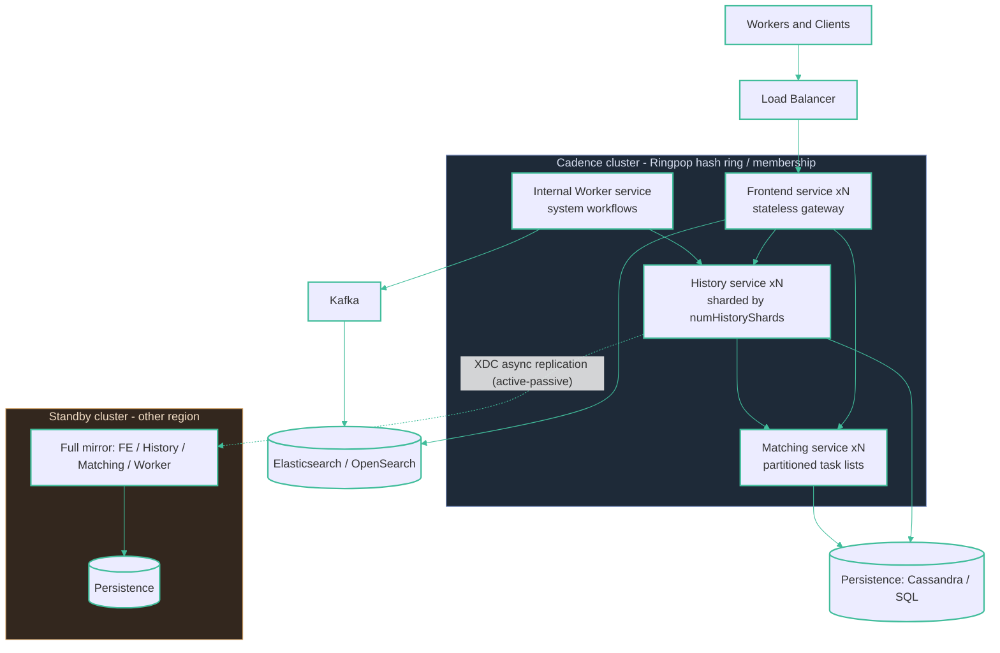

# Production — Cadence

A horizontally-scaled cluster of four Go services — Frontend (stateless gateway), History (stateful, sharded), Matching (task lists), Internal Worker — in front of a durable store and optional search/log layers. The History service is split into a **fixed, immutable `numHistoryShards`** distributed via a Ringpop hash ring; each shard serializes its workflows, so the shard count is the unit of parallelism and must be over-provisioned up front.

Multi-region HA uses **Cross-DC Replication (XDC)** with Global Domains in **active-passive only** — a domain is ACTIVE in exactly one cluster, with operator-triggered failover and at-least-once activity semantics across the switch.
