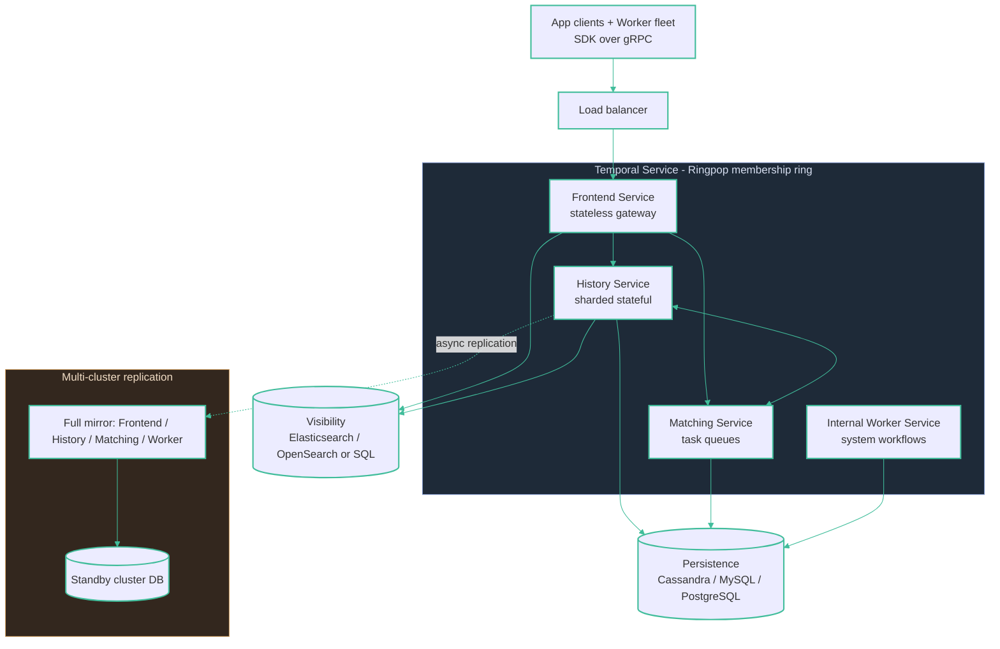

# Production — Temporal

The same four Go services as Cadence (Frontend, History, Matching, internal Worker) discovering each other over Ringpop, fronting a clustered DB (Cassandra / MySQL 8+ / PostgreSQL 12+). Visibility lands in the same SQL store (standard) or Elasticsearch/OpenSearch (advanced). The **History Shard count is the master, immutable scaling parameter** (≈1 History instance per ~500 shards); in practice the persistence DB and the ES cluster are the real bottleneck.

HA baseline is multiple replicas + clustered DB, with multi-cluster async replication (active→passive). **Temporal Cloud HA namespaces** add same-region / multi-region / multi-cloud (AWS↔GCP) active-standby with automatic failover (~20-min RTO, sub-1-min RPO, 99.99% SLA).
