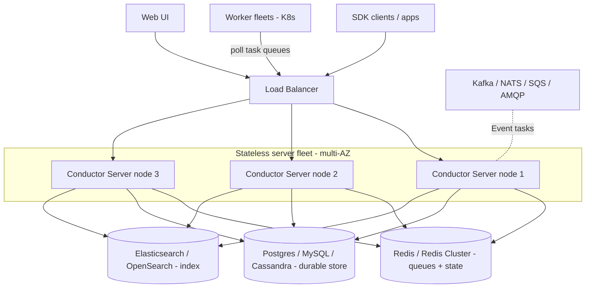

# Production — Conductor

A horizontally scalable cluster of **stateless** Conductor Server nodes (run ≥3 across AZs) behind a load balancer, sharing an external HA data tier: Redis (or Redis Cluster) for state/queues, a relational/NoSQL store for durability, and Elasticsearch/OpenSearch for indexing. Worker fleets are independent and poll the servers; brokers integrate via Event tasks.

Because the engine layer is stateless, you scale it just by adding nodes — pressure falls on the **data tier** (Redis and Postgres CPU/IOPS), which must run replicated for HA. Orkes advertises up to 99.99% with auto-failover; active-active multi-region is an enterprise/contract concern.
