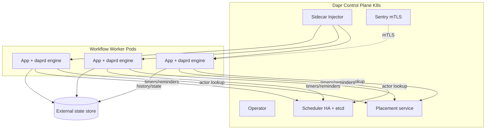

# Production — Dapr Workflows

Typically Kubernetes: a control plane (Operator, Sentry for mTLS, Placement, Scheduler) plus the Sidecar Injector. Each worker pod gets a `daprd` sidecar with the embedded `durabletask-go` engine and actor runtime — **there is no dedicated workflow cluster**; the engine scales with your app pods while Placement load-balances the workflow/activity actors. State is event-sourced into an external transactional+ETag store, and timers/reminders live in the Scheduler's etcd.

The **key constraint**: a single workflow instance is a single-threaded actor pinned to one node, so an individual workflow can't be scaled (activities can still fan out). HA is delegated to the chosen state store + Scheduler etcd; there is no built-in cross-region workflow replication — multi-region rides on the datastore's geo-replication.
