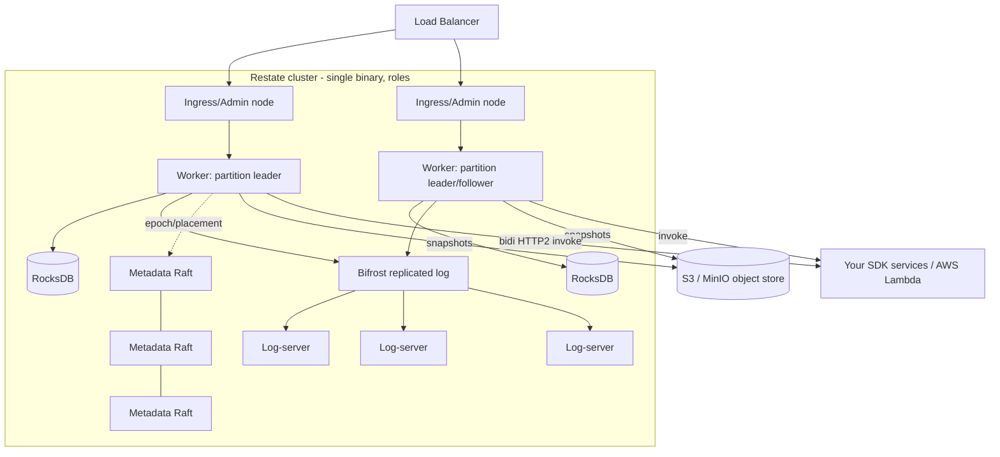

# Production — Restate

The same single binary run as a multi-node cluster with four colocatable node **roles**: worker, log-server, metadata-server, admin/ingress. The replicated durable log (**Bifrost**) is the source of truth; each partition has one leader processor tailing the log and materializing state in embedded RocksDB, with object storage (S3/MinIO) holding snapshots. Your handler code runs **outside** the cluster as stateless HTTP services on K8s or AWS Lambda.

Scaling is key-based sharding — workflow IDs, virtual-object keys and idempotency keys hash to a partition, so all steps/state/timers for a key run in one partition with no hot-path cross-partition coordination. HA comes from quorum replication, epoch fencing (no split-brain) and snapshot-bounded recovery; multi-AZ/region is a single stretched cluster via location-aware replication.
