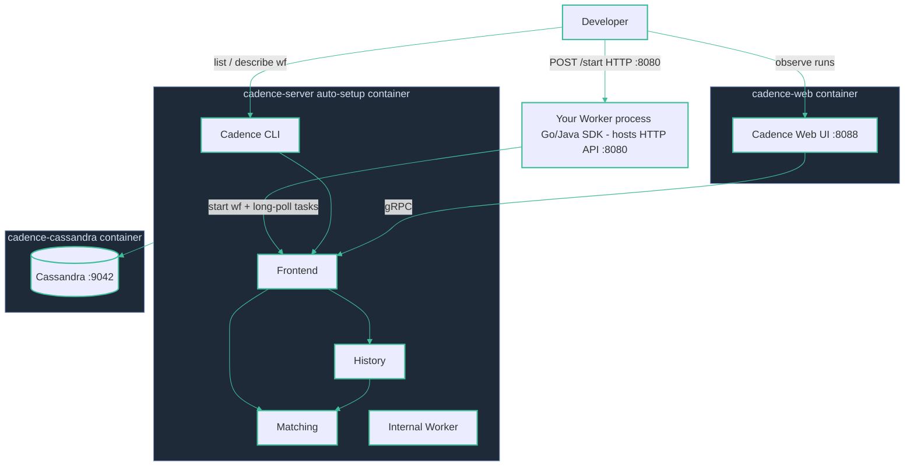

# Local dev — Cadence

**`docker compose up`** — three containers: `cadence-server` (auto-setup: Frontend, History, Matching + Internal Worker, with the CLI bundled in), `cadence-web` (Web UI :8088), and `cadence-cassandra` (persistence). You run your own Worker process, which hosts an HTTP API on :8080 — a `POST /start` kicks off the workflow via the SDK client.
