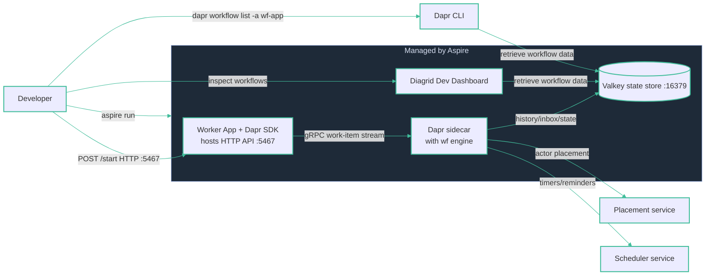

# Local dev — Dapr Workflows

**`aspire run`** — Aspire owns the lifecycle of the Worker App, its Dapr sidecar and the Valkey state store. No separate workflow server: the engine is embedded in the `daprd` sidecar and durability rides on the state store. The developer triggers a run with `POST /start`; the Dapr CLI reads workflow data from the state store to list instances.
