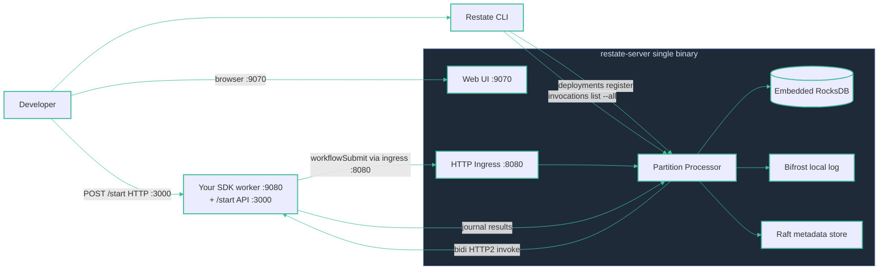

# Local dev — Restate

**One `restate-server` binary** — runtime, embedded RocksDB, durable log, metadata store and Web UI in a single process. Your handlers run as a plain HTTP service. The developer triggers a run with `POST /start` (a thin Express wrapper that forwards to the ingress); the Restate CLI lists invocations straight from the server.
